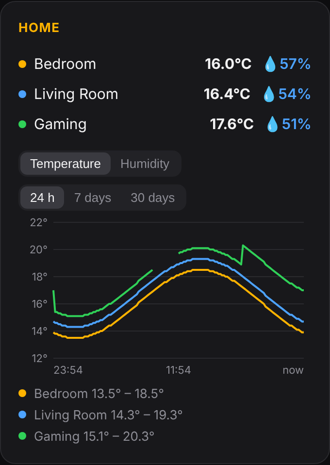

# Home Assistant: room temperature and humidity

SubCounter can show readings from temperature and humidity sensors that are already in your Home Assistant. Any sensor HA shows works the same way: Matter (for example IKEA TIMMERFLOTTE), Thread, Zigbee or ESPHome. The board doesn't talk to the sensors itself. It asks Home Assistant for the latest readings once a minute, over your home network.

You need v14.3 or later.

## 1. Find your Home Assistant address

Use the address you open Home Assistant with in a browser, **with the IP address, not `homeassistant.local`**. Home Assistant usually uses port **8123**, for example `http://192.168.1.20:8123`.

If you're not sure about the port, type just the IP address. **Find sensors** (step 3) tries `:8123` by itself and corrects the box if that's where HA answers.

## 2. Make an access token in Home Assistant

1. *(Recommended)* Make a separate user for the board: **Settings → People → Users → Add user** (for example "SubCounter"), with **Administrator** turned off. Log in to Home Assistant as that user for the next steps.
2. Click your name at the bottom left (your profile), then the **Security** tab.
3. Scroll to **Long-lived access tokens** → **Create token**, give it a name (for example "SubCounter") and copy the token. Home Assistant only shows it once.

A non-admin user can read sensor values but can't change your Home Assistant settings, so that's all the board can do with the token.

## 3. Set it up on the board

1. Open the board's **Settings** page → **Home Assistant**.
2. Paste the address and the token.
3. Press **Find sensors**. The board lists every temperature and humidity sensor in Home Assistant and fills in a room for each device it finds, pairing each temperature sensor with the humidity sensor from the same device.
4. Rename the rooms (for example "Lounge" or "Bedroom"). To pick sensors yourself, tap a sensor box to choose from the list. **+ Add a room** adds another row, up to 6. Clear a room's sensors to remove it.
5. Press **Save**. The board restarts.

The token is saved on the board as a secret. Like your other keys, it's left out of settings backups unless you choose *Download including passwords, keys and sign-ins*.

## Where the readings appear

- **On the board:** long-press the screen → swipe left → **Home**. With one or two rooms, each gets a big line. With more, there are three to a page: swipe up/down or press BOOT for the next page. Shake to refresh. The outside temperature from the Weather app is shown at the top for comparison.
- **On the idle clock:** the bottom line shows your rooms, as many as fit at a time, taking turns every 4 seconds (turn this off with *Show the rooms on the idle clock too*). If rain is on the way, the rain warning is one of the turns.
- **On the dashboard:** a **Home** card in the side column.

Readings older than 15 minutes (a sensor offline or out of battery) are shown greyed out.

## If it doesn't work

| Message | What to do |
|---|---|
| *Can't reach Home Assistant* | Check the address and port. Open it in a browser on the same Wi-Fi. Use the IP, not `homeassistant.local`. |
| *Home Assistant didn't accept the token (401)* | Make a new long-lived token and paste it again. Check that you copied all of it. |
| *That address answered, but not as Home Assistant (404)* | Something else is on that address or port. Try `:8123`. |
| *Sensor not found: sensor.xxx* | The sensor was renamed or removed in Home Assistant. Press **Find sensors** again. |

`/debug` on the board shows when Home Assistant last answered, and any error.

**Security:** if your board is reachable from the internet (a port forward), set a settings PIN (Settings → Security) so nobody else can see or change the Home Assistant details.
